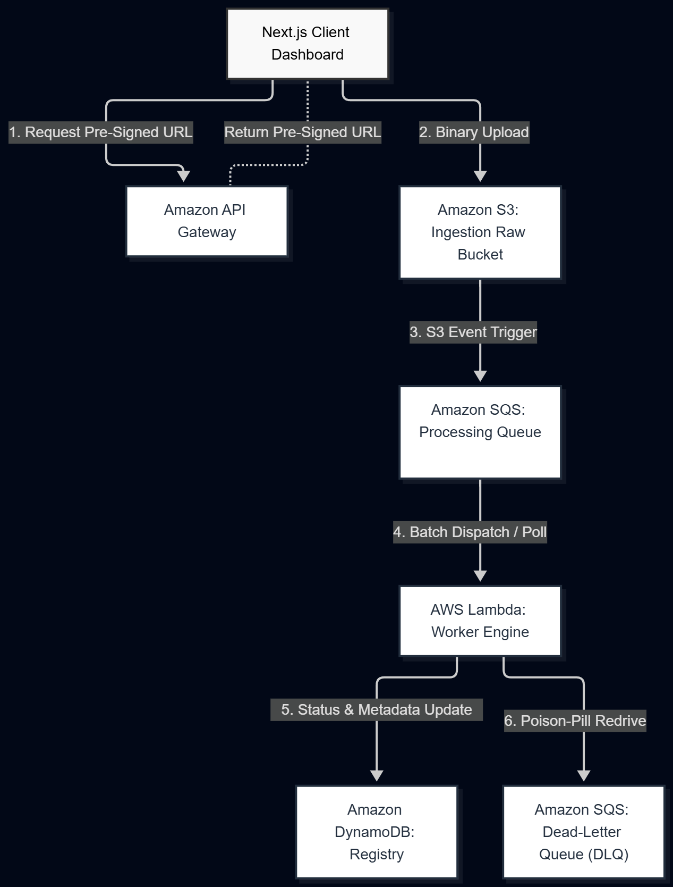

# Resilient Multi-Format Media Processing Pipeline

An event-driven, zero-trust serverless cloud architecture deployed on **AWS (ap-south-1)** using 13 AWS Services and Next.js.



---

## 🌟 Key Engineering Highlights

- **Secure Direct Ingestion:** Client uploads directly to Amazon S3 via short-lived (5-minute) Pre-Signed URLs generated by API Gateway & AWS Cognito.
- **Asynchronous Load-Leveling:** S3 events fan-out to Amazon SQS queues to buffer traffic spikes and prevent Lambda worker starvation.
- **Deep Magic-Byte Perimeter Security:** Lambda workers bypass user file extensions and inspect raw binary headers (`%PDF-`, `\x89PNG`, `ftyp`) to detect extension spoofing (e.g., renamed executables) instantly.
- **Fault Containment & DLQ Isolation:** Sandboxed execution traps C-library errors cleanly, marking corrupted files as `QUARANTINED`. Persistent poison-pill payloads are automatically routed to an SQS Dead-Letter Queue (DLQ) after 3 retries.
- **Distributed Observability:** AWS X-Ray and CloudWatch tracing confirm <800ms worker duration and a 0% unhandled fault rate.

---

## 🛠️ Architecture & Tech Stack

- **Frontend:** Next.js, React, Tailwind CSS
- **Compute:** AWS Lambda (Python 3.12)
- **Orchestration & Messaging:** Amazon SQS, SQS DLQ, AWS Step Functions
- **Storage & Database:** Amazon S3 (Raw & Processed), Amazon DynamoDB
- **Security & Observability:** AWS Cognito, API Gateway, AWS IAM, AWS X-Ray, AWS CloudWatch

---

## 📂 Repository Structure

```text
├── docs/                      # Architecture diagrams, PDF project report & PPT deck
├── lambda/                    # AWS Lambda backend Python handlers (api_handler & media_worker)
└── frontend/                  # Next.js live management dashboard